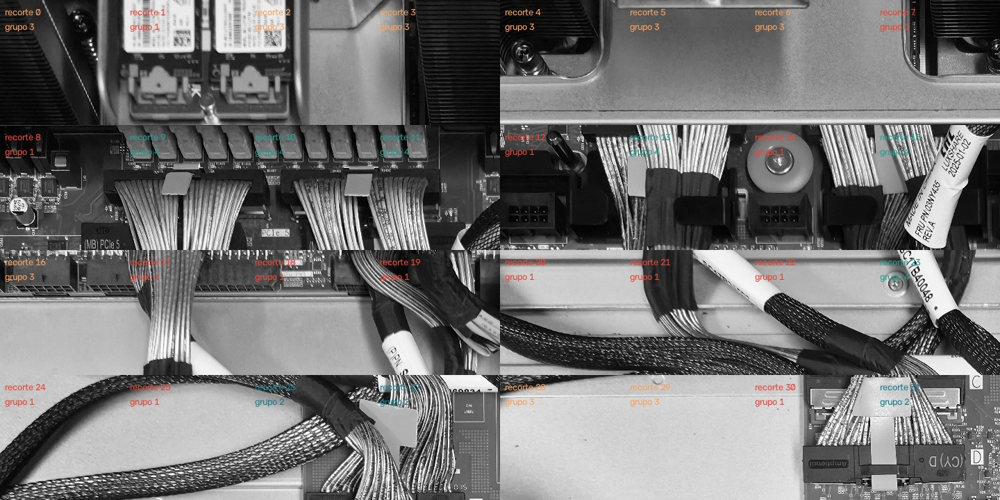
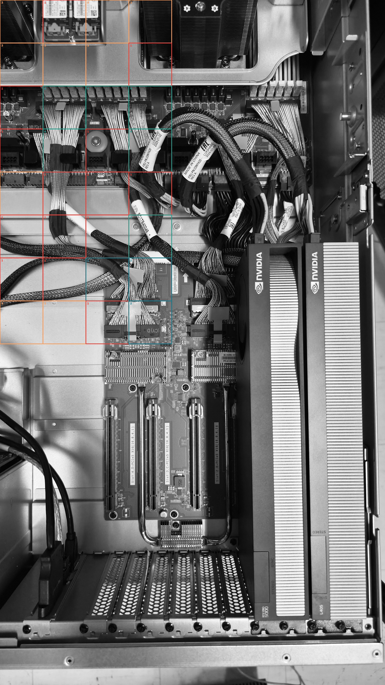

# Segmentacao de uma imagem por textura usando filtros classicos

**Disciplina:** Visao Computacional  
**Aluno:** Bruno Sime Ferreira Nunes  
**Repositorio:** https://github.com/bruno-sime/computerVision  
**Implementacao:** C++17 e OpenCV

## Resumo

Este trabalho apresenta uma segmentacao nao supervisionada baseada em textura, sem uso de inteligencia artificial. Uma fotografia de uma placa eletronica foi convertida para tons de cinza e dividida em 32 regioes de 512 x 512 pixels. Cada regiao foi representada por um vetor de 24 atributos, calculados a partir da media do modulo da resposta de oito filtros de textura em tres escalas. Os vetores foram padronizados e agrupados pelo algoritmo K-Means, usando distancia euclidiana. O resultado foi desenhado sobre a imagem e tambem organizado em uma montagem para facilitar a interpretacao visual.

**Palavras-chave:** textura, filtros lineares, multiescala, K-Means, segmentacao classica.

## 1. Introducao

Texturas diferentes produzem respostas diferentes quando uma imagem e processada por filtros direcionais, passa-alta e circulares. Essa propriedade permite descrever pequenas regioes por medidas numericas e agrupar regioes semelhantes, mesmo sem fornecer previamente a classe correta de cada uma.

O enunciado solicita filtros em pelo menos quatro orientacoes, incluindo horizontal, vertical, 45 graus e 135 graus, alem de um filtro circular. Tambem solicita processamento em tres escalas, vetores de 24 dimensoes, agrupamento de regioes semelhantes e uma imagem final com a categorizacao. A implementacao atende esses requisitos com oito filtros em tres escalas, formando exatamente 24 valores por recorte.

## 2. Dados utilizados

Foi utilizada a imagem `image.jpg`, uma fotografia colorida feita com um telefone celular. O programa le a imagem e a converte para tons de cinza com `cv::imread(..., cv::IMREAD_GRAYSCALE)`, eliminando a dependencia da informacao de cor.

| Propriedade | Valor |
|---|---:|
| Formato original | JPEG RGB |
| Dimensoes da fotografia | 8160 x 4592 pixels |
| Imagem usada no processamento | 8160 x 4592 pixels, tons de cinza |
| Tamanho de cada regiao | 512 x 512 pixels |
| Numero de regioes | 32 |
| Numero de grupos | 4 |

Os 32 recortes sao regioes da mesma fotografia, e nao 32 fotografias independentes. Essa escolha permite cumprir o requisito de analisar ao menos 32 amostras de textura mantendo a grade de recortes solicitada.


*Figura 1 - Fotografia utilizada como entrada.*

## 3. Metodologia

### 3.1 Recortes

As regioes sao obtidas em uma grade regular, sem ampliar a imagem. Para cada recorte sao armazenadas a linha e a coluna do canto superior esquerdo. Essas coordenadas tambem sao exportadas no arquivo `descritores_24d.csv`.

### 3.2 Banco de filtros

Foram utilizados oito filtros:

1. **Horizontal:** mascara Sobel que responde principalmente a variacoes horizontais.
2. **Vertical:** transposta do filtro horizontal.
3. **45 graus:** mascara direcional diagonal.
4. **135 graus:** mascara direcional diagonal complementar.
5. **Laplaciano:** realca variacoes de intensidade em varias direcoes.
6. **LoG:** aproximacao discreta do Laplaciano do Gaussiano em uma mascara 7 x 7.
7. **Difusao:** mascara gaussiana de media zero, usada para medir variacoes locais.
8. **Circular:** mascara em forma de coroa circular, com coeficiente central negativo e soma total zero.

As quatro primeiras mascaras atendem diretamente as orientacoes pedidas no enunciado. O filtro circular acrescenta uma resposta sensivel a estruturas aproximadamente radiais.

### 3.3 Tres escalas

O processamento e feito com uma piramide Gaussiana. A primeira escala usa a imagem original; a segunda reduz a imagem para metade em cada dimensao; a terceira reduz novamente para um quarto das dimensoes originais. Em cada escala, os oito filtros sao aplicados com `cv::filter2D`.

Para evitar efeitos artificiais nas bordas, a convolucao usa reflexao (`BORDER_REFLECT101`).

### 3.4 Vetores de caracteristicas

Para um recorte $R$, uma escala $s$ e um filtro $k$, o atributo e calculado por:

$$
f_{s,k}(R) = \frac{1}{|R|}\sum_{(x,y)\in R} |(I_s * h_k)(x,y)|
$$

em que $I_s$ e a imagem na escala $s$, $h_k$ e o filtro e $*$ representa a convolucao. A media do modulo mede a energia media da textura, sem cancelar respostas positivas e negativas.

Como existem 8 filtros e 3 escalas, o descritor e:

$$
v(R) = [f_{1,1}, ..., f_{1,8}, f_{2,1}, ..., f_{2,8}, f_{3,1}, ..., f_{3,8}] \in \mathbb{R}^{24}
$$

O CSV nomeia explicitamente cada coluna, por exemplo `escala1_horizontal` e `escala3_circular`.

### 3.5 Agrupamento

Antes do agrupamento, cada uma das 24 colunas e padronizada com media zero e desvio-padrao unitario. Isso impede que filtros com respostas numericamente maiores dominem a distancia.

O agrupamento utiliza K-Means com 4 grupos, inicializacao `KMEANS_PP_CENTERS`, 20 tentativas e criterio de parada de no maximo 100 iteracoes ou variacao menor que $10^{-5}$. O algoritmo minimiza a soma das distancias euclidianas quadraticas entre cada vetor e o centro do grupo:

$$
J = \sum_{i=1}^{n} \left\|z_i - \mu_{c_i}\right\|_2^2
$$

## 4. Implementacao

O programa foi desenvolvido em C++17 usando OpenCV. A compilacao e feita por CMake e o executavel utiliza os modulos `core`, `imgcodecs` e `imgproc`.

```bash
cmake -S . -B build -G Ninja -DOpenCV_DIR="$(brew --prefix opencv)/lib/cmake/opencv4"
cmake --build build
./build/segmentacao_textura image.jpg resultados_cpp 32 4
```

O uso do gerador Ninja e necessario neste workspace porque o caractere `:` no nome do caminho causa conflito com regras do gerador Make.

## 5. Resultados

A execucao realizada produziu 32 vetores com 24 atributos cada. A distribuicao dos grupos foi:

| Grupo | Numero de recortes |
|---:|---:|
| 1 | 14 |
| 2 | 3 |
| 3 | 9 |
| 4 | 6 |

A compactacao final informada pelo K-Means foi **151,077** na matriz padronizada. Esse valor serve para comparar configuracoes diferentes do experimento, mas nao representa uma porcentagem de acerto, pois nao existem rotulos manuais de referencia.



*Figura 2 - Montagem dos 32 recortes com os grupos atribuidos.*



*Figura 3 - Grupos desenhados sobre a fotografia original. Numeros e cores representam os grupos.*

O arquivo `descritores_24d.csv` contem as coordenadas de cada recorte, os 24 atributos e o grupo atribuido. O arquivo `descritores_24d.npy` armazena a mesma matriz numerica no formato binario NumPy, com dimensao `(32, 24)`.

## 6. Discussao

O metodo separa regioes com respostas medias de textura diferentes. Regioes com bordas, trilhas e detalhes finos tendem a apresentar respostas maiores nos filtros direcionais e no Laplaciano. Regioes mais uniformes tendem a apresentar respostas menores. As escalas permitem que o descritor considere tanto detalhes pequenos quanto estruturas mais largas.

O resultado nao deve ser interpretado como uma segmentacao semantica. O algoritmo nao sabe o que e um componente, uma trilha ou uma superficie: ele apenas agrupa regioes com vetores de textura semelhantes. Por isso, regioes visualmente diferentes podem cair no mesmo grupo quando possuem energia de textura parecida.

## 7. Limitacoes e melhorias

- O experimento utiliza 32 regioes de uma unica fotografia; o ideal para uma avaliacao mais completa seria construir um conjunto com pelo menos 32 fotografias ou varias imagens de cada classe.
- Os grupos sao obtidos sem rotulos, portanto nao ha acuracia supervisionada para medir.
- A grade regular pode dividir um objeto entre dois recortes.
- O numero de grupos foi escolhido como 4. Uma extensao seria comparar varios valores de $K$ usando o cotovelo ou o indice de silhueta.
- Tambem seria possivel testar filtros Gabor classicos, janelas sobrepostas e outras dimensoes de recorte.

## 8. Conclusao

Foi desenvolvida uma solucao classica em C++ para segmentacao por textura. A implementacao converte a fotografia para tons de cinza, utiliza orientacoes horizontal, vertical, 45 graus e 135 graus, inclui um filtro circular, processa tres escalas e produz descritores de exatamente 24 dimensoes. O agrupamento por K-Means gera uma categorizacao visual das 32 regioes e exporta os dados para analise posterior. O resultado atende ao objetivo de um primeiro experimento funcional de visao computacional sem uso de IA.